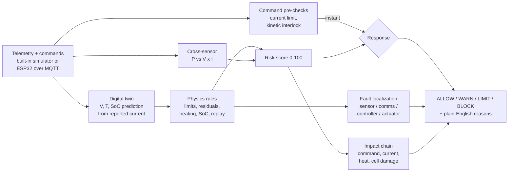

<div align="center">

# 🛡️ AxiomWall

### A physics-plausibility firewall for connected EVs and energy systems

**Traditional security asks _"who sent this?"_ AxiomWall asks _"does this make physical sense?"_**


**Team Sprout.exe** · Chennai Institute of Technology
Built for **VIT Sustainathon** · Sustainable AI & Cybersecurity track · **PS AI-01: The Physically Plausible Cyberattack Problem**

<!-- TODO: add the deployed link once available, e.g. [🚀 Live Demo](https://your-app.vercel.app) · -->
[🎬 Demo Walkthrough](#-demo-walkthrough-2-minutes) · [🔌 Hardware (Wokwi)](#-hardware-in-the-loop-wokwi-esp32) · [📊 Detection Results](#-detection-results) · [👥 Team](#-team)

</div>

---

## 📌 The 30-second pitch

An attacker who can make a battery sensor lie does not need to break any encryption. A forged temperature reading that is correctly formatted, correctly signed and sent by an authorised device passes every conventional security check, while the pack quietly overheats.

**AxiomWall adds the missing layer.** It compares every telemetry sample and every command against battery and thermal physics and against a live digital twin. When the digital status says **VALID** but the physical status says **IMPLAUSIBLE**, it raises a risk score, pinpoints which part of the system is probably compromised, predicts the physical damage, and recommends **Allow / Warn / Limit / Block**, with the evidence explained in plain English.

> **Honesty note.** All telemetry is simulated (a built-in simulator or an ESP32 running in Wokwi). _Limit_ and _Block_ are recommended gateway actions, not enforcement on a real vehicle.

---

## 🚨 The problem

Modern EVs, chargers and grid-connected storage rely on digital communication. A malicious command or falsified sensor value can pass every standard check and still produce physically abnormal behaviour:

| Check | What it validates | Can it catch a frozen temperature sensor? |
|---|---|---|
| Message signature / authentication | _Who_ sent the message | ❌ No, the sender is legitimate |
| Format and range validation | _Whether_ the value looks well-formed | ❌ No, 31 °C is a perfectly valid number |
| **AxiomWall physics check** | _Whether_ the value is physically possible right now | ✅ Yes, at 100 A the pack must be warming |

## 💡 How it works



The twin reads **only the reported current**. It never reads the reported temperature or SoC, so a spoofed sensor cannot contaminate the prediction it is being judged against.

---

## ✨ Features

| # | Feature | What it does | Where |
|---|---|---|---|
| 1 | **Physics plausibility engine** | Hard limits, twin residuals, heating-rate suppression, SoC conservation, replay detection | `src/engine/rules.js` |
| 2 | **Digital twin** | 16S LFP pack: OCV(SoC) − I·R, I²R heating with thermal loss, coulomb counting | `src/engine/twin.js`, `TwinChart.jsx` |
| 3 | **Cross-sensor consistency** | Reported power vs V × I | `src/engine/crossSensor.js` |
| 4 | **Command pre-checks** | Unsafe `SET_CURRENT` and `DISCHARGE_OFF` while moving are blocked before they execute | `rules.js`, `risk.js` |
| 5 | **Fault localization** | Names the likely origin (Sensor, Comms, Controller, Actuator) with a confidence value | `src/engine/localize.js`, `LocalizationPipeline.jsx` |
| 6 | **Impact prediction** | Command → Current → Heat → Cell damage, with an estimated time to damage | `src/engine/impact.js`, `ImpactChain.jsx` |
| 7 | **Graded response** | 0–100 risk score with hysteresis and gradual recovery | `src/engine/risk.js`, `RiskGauge.jsx` |
| 8 | **Attack Lab** | Seven one-click scenarios with an intensity slider | `AttackLab.jsx` |
| 9 | **Explainable dashboard** | Digital vs Physics verdict, rule-by-rule "why", incident feed, firewall console | `DigitalVsPhysical.jsx`, `IncidentFeed.jsx`, `FirewallConsole.jsx` |
| 10 | **Hardware-in-the-loop** | Switch the data source to a live ESP32 simulated in Wokwi | `WokwiLink.jsx`, `src/sim/wokwiLink.js`, `wokwi/` |
| 11 | **Telemetry inspector** | Raw sample, twin values and residuals side by side | `TelemetryInspector.jsx` |
| 12 | **Sustainability card** | Estimated damage and e-waste avoided, from editable assumptions (not measured data) | `SustainabilityCard.jsx` |

---

## ⚔️ Attack Lab

Every attack falsifies **only the reported stream**. The simulated true pack keeps obeying physics, which is exactly what the twin exploits.

| Attack | What the attacker does | Rules that catch it | Response |
|---|---|---|---|
| **Temperature freeze** | Pins reported T while the true pack is forced to 100 A | `heating_rate`, `twin_t` | WARN → LIMIT |
| **Replay** | Loops the last 10 clean samples | `replay` | WARN |
| **SoC jump** | Adds up to +20 % to reported SoC | `twin_soc`, `soc_conservation` | WARN |
| **Coordinated spoof** | Falsifies I and V together while P stays unchanged | `power_consistency`, `twin_v` | WARN |
| **Malicious command** | Valid `SET_CURRENT = 120 A` while charging (limit 60 A) | `command_limit` (pre-check) | **BLOCK** instantly |
| **DISCHARGE_OFF at speed** | Cuts discharge while the vehicle is moving at ~32 km/h | `kinetic_interlock` (pre-check) | **BLOCK** instantly |
| **Legit fast-charge ramp** | _Not an attack_: current ramps 20 → 55 A | none | ALLOW (no false alarm) |

Each attack shows the same moment: **Digital VALID, Physics IMPLAUSIBLE**, then the verdict and the reasons.

---

## 📊 Detection results

Measured on the built-in simulator with sensor noise, attack starting at t = 20 s. Single runs, shown to illustrate behaviour rather than as a statistical benchmark.

| Scenario | First non-ALLOW | Peak response |
|---|---|---|
| Legit drive, charge and fast-charge ramp (90 s each) | none, **0 false alarms** | ALLOW |
| Temperature freeze at 100 A | about 5 s | LIMIT (risk ≈ 50–70) |
| SoC jump (+15 %) | about 1 s | WARN |
| Coordinated spoof | about 1 s | WARN |
| Replay | about 10 s (needs 10 matching samples) | WARN |
| Malicious `SET_CURRENT` / `DISCHARGE_OFF` at speed | 0 s | BLOCK |

---

## 🔌 Hardware-in-the-loop (Wokwi ESP32)

The [`wokwi/`](wokwi) folder holds the exact circuit and firmware we used. An **ESP32 simulates the battery pack** with the same physics as the website's twin and publishes its _reported_ telemetry once per second over MQTT. The dashboard subscribes, converts each message to the same sample format the built-in simulator produces, and runs the entire engine on it unchanged.

```
wokwi/
├── diagram.json     circuit: ESP32 DevKit C v4, SSD1306 OLED, potentiometer, 5 buttons, 3 LEDs
├── sketch.ino       firmware: pack simulation, attack buttons, on-board guard, MQTT publisher
└── libraries.txt    Adafruit GFX Library, Adafruit SSD1306, PubSubClient
```

### Controls on the simulated board

| Input | Pin | Function |
|---|---|---|
| Potentiometer | GPIO 34 | Current magnitude (charge 0–55 A, drive 0–110 A) |
| Red button | GPIO 4 | Toggle **temperature freeze** |
| Orange button | GPIO 5 | Toggle **SoC +20 % spoof** |
| Purple button | GPIO 18 | Toggle **malicious `SET_CURRENT`** command (2× the safe limit) |
| Green button | GPIO 19 | Reset scenario |
| Blue button | GPIO 23 | Switch **CHARGE / DRIVE** |
| LEDs (green, yellow, red) | GPIO 25, 26, 27 | On-board guard state: SAFE, WARNING, ATTACK |
| OLED SSD1306 | I²C `0x3C` | Live readout: reported vs model T and SoC, alerts |

The firmware also runs a small **on-board guard** with its own slightly mis-tuned model (R_int 3 % off, like real life) as a second opinion. By default it only reports; setting `GUARD_CUTS_CURRENT = true` makes it open the simulated contactor on its own.

### Run it

1. Open [wokwi.com](https://wokwi.com), create a new **ESP32** project, and copy `diagram.json`, `sketch.ino` and `libraries.txt` from [`wokwi/`](wokwi) into it. <!-- TODO: add the Wokwi project link here -->
2. Press **Start Simulation** and wait for `MQTT:ok` on the OLED.
3. In the dashboard, open **Hardware-in-the-loop** and choose **Wokwi live**, then press **Start**.
4. Move the potentiometer, then press the attack buttons and watch the verdict change on the website.

The default topic is `bms-guard-ai01-7421/telemetry` on `broker.hivemq.com` (browser side: `wss://broker.hivemq.com:8884/mqtt`). The topic must match `TOPIC` in `sketch.ino`.

---

## 🔬 The physics

| Quantity | Model |
|---|---|
| Pack | 16S LFP, 100 Ah, ~48–58 V (piecewise-linear OCV table) |
| Terminal voltage | `V = OCV(SoC) − I · R_int` with `R_int = 0.03 Ω` |
| Heating | `C_th · dT/dt = I²·R_int − (T − T_amb) / R_th` with `C_th = 20 000 J/K`, `R_th = 0.05 K/W`, `T_amb = 28 °C` |
| Charge conservation | `ΔSoC % = −I · Δt / (3600 · Q_nom) · 100` |
| Sign convention | `I > 0` discharge/drive, `I < 0` charging |

> **Demo time-scale.** The thermal equation runs **×20 faster than real time** (`TC = 20`) so temperature excursions are visible in a short demo. It is applied only to the temperature equation and is shown in the app header. Times-to-damage in the dashboard are therefore demo-time, not real-time.

### Detection rules

| Rule | Fires when |
|---|---|
| `limit_*` | Charge > 60 A, drive > 120 A, V outside 44–60 V, T > 60 °C, reported dT/dt > 0.5 K/s |
| `twin_v`, `twin_t`, `twin_soc` | Residual vs twin exceeds tolerance (0.5 V, 1.5 K, 1.5 %); severity grows with the residual |
| `heating_rate` | Twin predicts heating > 0.05 K/s but the reported rate is under 20 % of it (5-sample window) |
| `soc_conservation` | SoC changes by more than 3× what the current implies, plus 0.3 % |
| `power_consistency` | Reported P differs from V × I by more than 5 % and 0.1 kW |
| `replay` | The last 10 T and V samples exactly match samples from 10–60 s earlier |
| `command_limit` | `SET_CURRENT` above 60 A (charging) or 120 A (driving) |
| `kinetic_interlock` | `DISCHARGE_OFF` commanded while moving with > 10 A flowing |

### Risk score and response

Each failing rule produces a severity from 0 to 1. The strongest four are combined:

```
risk = min(100, 45·s1 + 25·s2 + 15·s3 + 10·s4)      (s1 >= s2 >= s3 >= s4)
```

| Risk | Response |
|---|---|
| 0–24 | ✅ **ALLOW** |
| 25–49 | ⚠️ **WARN** |
| 50–74 | 🟠 **LIMIT** (cap current) |
| 75–100 | 🛑 **BLOCK** |

- `command_limit` and `kinetic_interlock` are **pre-checks**: they jump straight to risk 100 and BLOCK before the command runs.
- The displayed risk rises instantly but falls by at most 4 points per second.
- A response change must hold for 2 consecutive samples (hysteresis), which prevents flicker.

---

## 🧰 Tech stack

| Layer | Technology |
|---|---|
| Frontend | React 19, Vite 8, Tailwind CSS 4 |
| State | Zustand |
| Charts | Recharts |
| Messaging | MQTT.js over WebSocket (HiveMQ public broker) |
| Hardware simulation | ESP32 DevKit C v4 in Wokwi (Arduino C++, PubSubClient, Adafruit SSD1306) |
| Tooling | oxlint |

## 📁 Project structure

```
AxiomWall/
├── index.html
├── vite.config.js
├── public/                  favicon and background images
├── wokwi/                   ESP32 circuit + firmware for the hardware link
│   ├── diagram.json
│   ├── sketch.ino
│   └── libraries.txt
└── src/
    ├── App.jsx, main.jsx, index.css
    ├── components/          dashboard UI (AttackLab, RiskGauge, TwinChart, WokwiLink, ...)
    ├── engine/              physics and detection logic, no UI code
    │   ├── twin.js          battery and thermal digital twin
    │   ├── rules.js         plausibility rules and hard limits
    │   ├── crossSensor.js   power consistency
    │   ├── localize.js      fault localization
    │   ├── impact.js        impact chain and time-to-damage
    │   ├── risk.js          risk score, hysteresis, response
    │   └── index.js         evaluate() pipeline
    ├── sim/                 built-in telemetry simulator and Wokwi/MQTT link
    └── store/useStore.js    application state
```

## 🚀 Getting started

**Prerequisites:** Node.js 18 or newer and npm.

```bash
git clone https://github.com/sprout-exe/AxiomWall.git
cd AxiomWall
npm install
npm run dev
```

Open the URL Vite prints (usually `http://localhost:5173`). The app starts streaming automatically; no environment variables or accounts are needed.

| Script | Purpose |
|---|---|
| `npm run dev` | Start the development server |
| `npm run build` | Production build into `dist/` |
| `npm run preview` | Preview the production build |
| `npm run lint` | Run oxlint |

---

## 🎬 Demo walkthrough (2 minutes)

1. **Normal state.** Everything green: Digital VALID, Physics PLAUSIBLE, risk 0.
2. **Legit fast-charge ramp.** Current climbs 20 → 55 A and the verdict stays **ALLOW**. No false alarm.
3. **Temperature freeze.** Digital stays **VALID** while Physics flips to **IMPLAUSIBLE**; risk climbs to **LIMIT**.
4. **Open the twin chart.** At 100 A the pack must warm; the reported temperature stays flat.
5. **Read the "Why" panel and the localization card.** The fault is placed on the **sensor**, and the impact chain shows command → current → heat → cell damage.
6. **Malicious command.** A valid-looking `SET_CURRENT 120 A` while charging is **BLOCKED instantly**, before it executes.
7. **Switch to Wokwi live.** Press the same attacks on the simulated ESP32 and watch the website react.

---

## ⚠️ Limitations

- **Simulated data.** No real vehicle, charger or BMS is connected.
- **The digital layer is a stub.** "Signed & authenticated" is a simulated policy flag, not real cryptography.
- **Same physics on both sides.** The simulated plant and the twin share equations, so the twin is a perfect model by construction. Real packs have parameter drift, ageing and temperature-dependent resistance.
- **Fixed thresholds.** Limits and tolerances are hard-coded for one 16S LFP pack and have not been tuned on real data.
- **Replay detection needs exact copies.** Replayed data with added noise would not match.
- **Subtle attacks can slip through.** Spoofs smaller than the residual tolerances, or a freeze at low current, produce little or no alert.
- **Public MQTT broker.** The demo topic is unauthenticated and visible to anyone, so it is not suitable for anything beyond demonstration.
- **Recommendations only.** Real enforcement belongs in an edge gateway or the BMS.

## 🗺️ Roadmap

- [ ] Validate the twin against a real battery dataset and add parameter-mismatch testing
- [ ] Sign MQTT payloads (HMAC) and use a private broker, making the digital layer real
- [ ] Online parameter estimation so the twin tracks ageing and temperature effects
- [ ] Automated test suite and CI for the detection engine
- [ ] Real CAN bus ingestion and an edge-gateway build that enforces Limit and Block
- [ ] Extend the model to chargers and grid-side storage

---

## 👥 Team

**Team Sprout.exe** · Chennai Institute of Technology

| Name | Role |
|---|---|
| **Karthikeyan V** | Team Lead |
| **Barath Vikraman S V** | UI/UX Designer |
| **Vishva P** | Hardware Designer |
| **Kathy Prasanna P** | Hardware Designer |

## 📄 License

Released under the [MIT License](LICENSE).

## 🙏 Acknowledgments

Built for **VIT Sustainathon**. Hardware simulated with [Wokwi](https://wokwi.com). Background imagery is stock photography used for demonstration only.
